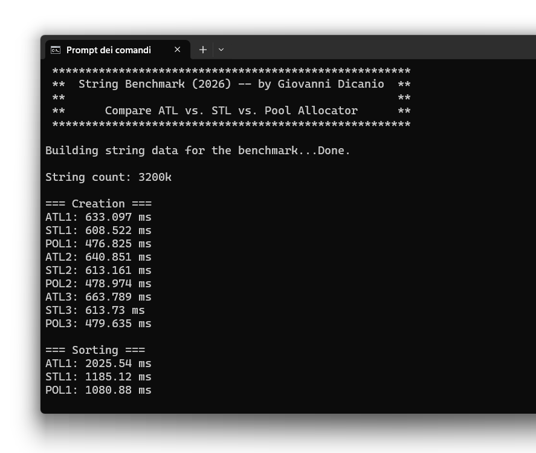

# StringBenchmarkStlAtlPool
## A C++ string benchmark, comparing the performance of STL strings vs. ATL CString vs. Custom Pool Allocator strings 

by Giovanni Dicanio

Related [blog post](https://giodicanio.com/2026/11/15/c-plus-plus-string-benchmark-stl-vs-atl-vs-custom-pool-allocator-2026-11-14/).

The **string pool allocator code** is implemented in the [`StringPool.hpp`](./StringBenchmarkStlAtlPool/StringPool.hpp) 
and [`StringPool.cpp`](./StringBenchmarkStlAtlPool/StringPool.cpp) files.

The code compiles cleanly at warning level 4 (`/W4`) with VS 2022, in both 64-bit and 32-bit builds. It requires at least C++17; it builds successfully in C++20 mode as well.

The benchmark code is in the [`StringBenchmarkStlAtlPool.cpp`](./StringBenchmarkStlAtlPool/StringBenchmarkStlAtlPool.cpp) file.

There is also an Excel file containing a [sample of benchmark results](./docs/Benchmark_Results.xlsx).

(The pool allocator code is based on an initial idea in a blog post published on The Old New Thing blog; the [original code](./StringBenchmarkStlAtlPool/original_code.cpp) from that blog post is included in this repo.)

